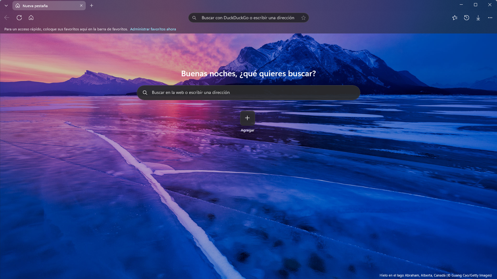
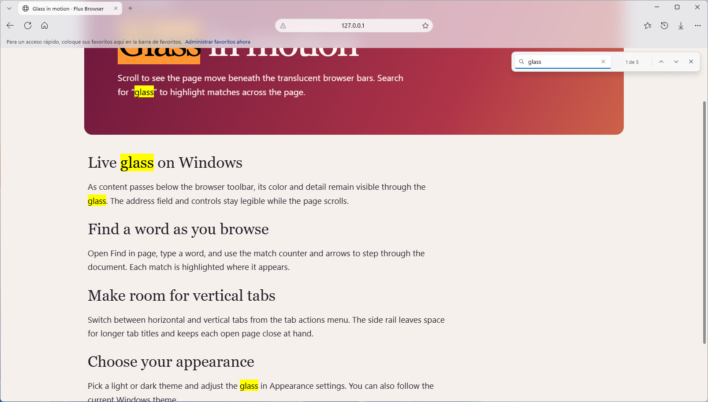
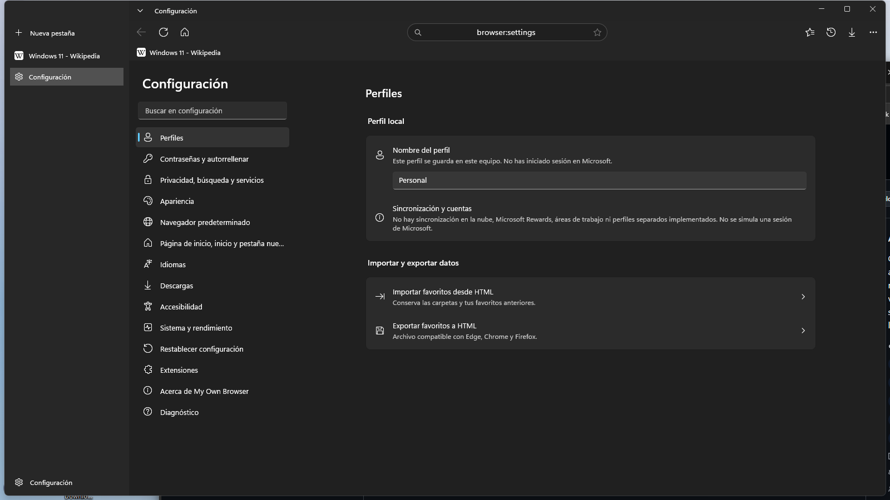
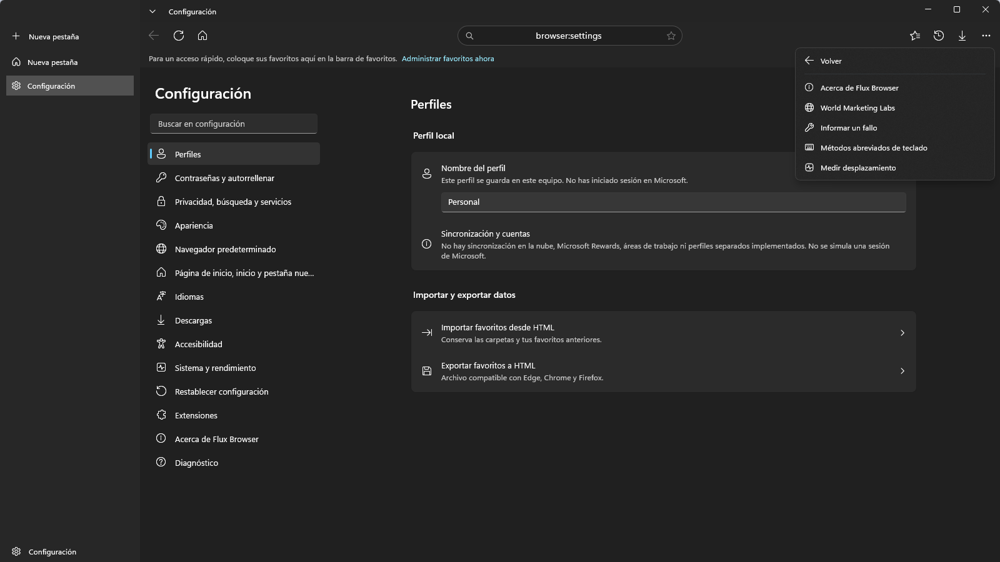
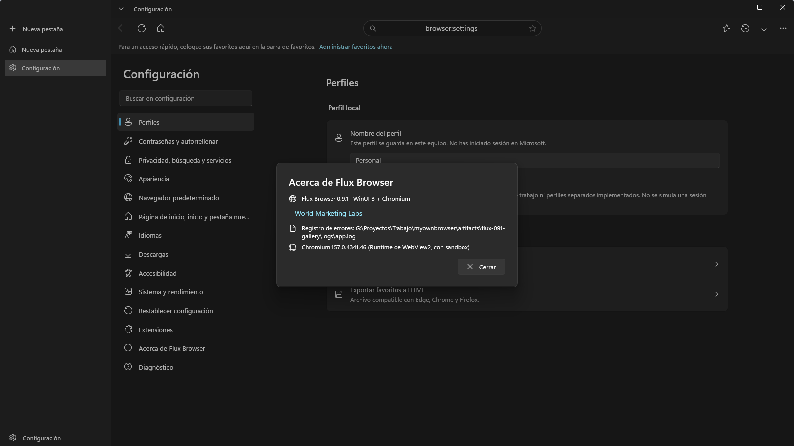
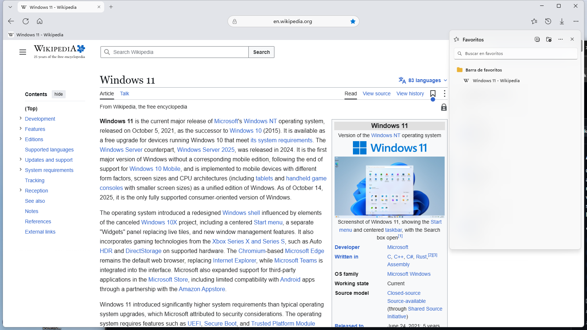

# Changelog

**English** · [Español](CHANGELOG.md)

All notable changes to Flux Browser. Entries link to the published downloads.

## [Unreleased]

## [0.9.2] - 2026-11-13

### Highlights

- Type a search or a web address immediately after opening the built-in new tab.
- GitHub presents the same features, screenshots and version notes in English and Spanish, with English first.

### Added

- English and Spanish project pages, a full screenshot gallery in each, and matching release notes and support documents.

### Screenshots

### Changed

- The address bar and the new-tab search field share the same input handling for searches and web addresses.
- The address bar is available on internal pages while Chromium initializes.

### Fixed

- New tabs now take keyboard focus as soon as their search field is ready. The hidden web engine cannot reclaim focus from the new-tab page.
- Invalid input stays in the new-tab search field so it can be corrected.
- A search or address submitted before the engine finishes starting is retained and loaded when the engine is ready.

## [0.9.1] - 2026-11-13

### Changed

- Standardized Flux Browser across Help, About, diagnostics, Windows paths and registration, source code and packaging. Added screenshots of Help and About.
- Existing profiles move to the Flux Browser directory when a new profile does not already exist. The old default download path is upgraded and custom paths are preserved.

### Screenshots

## [0.9.0] - 2026-11-13

### Highlights

- First technical preview of Flux Browser by World Marketing Labs, with live glass bars, horizontal and vertical tabs, and WebView2 as the default engine.
- A per-user EXE installer, portable ZIP, SHA-256 checksums, screenshot gallery, privacy policy, issue form and publication documentation.
- An x64 MSIX preview with WebView2 and Windows HTTP/HTTPS activation.

### Screenshots

### Added

- Compositor animations for menus, panels, search and the new-tab page, along with themed controls, icon feedback and consistent Windows 11 spacing.
- Local address suggestions from open tabs, bookmarks and history, find-in-page match count, a zoom indicator and loading and audio indicators in tabs.
- WebView2 sleeping tabs, configurable tracking prevention, private engine profiles, a glass context menu and site permission prompts.
- Tab dragging within and across windows, hover previews with page thumbnails, animated custom tabs, and vertical tabs with compact controls.
- A full-bleed new-tab background, narrow-window settings navigation, native printing, screenshots, MHTML saving and browsing-data deletion.
- Per-user HTTP/HTTPS registration, command-line URL activation and profile overrides, optional persistent sessions, lazy tab restoration and GPU-failure restart.
- Rotating logs, startup measurements, xUnit coverage, CI, Dependabot, two-engine smoke tests and self-contained ReadyToRun packaging.

### Changed

- WebView2 is the default sandboxed engine and CEF is the experimental fallback. The web engine abstraction preserves both paths.
- WebView2 glass uses page padding and backdrop filters, with a scrollbar fixed below the chrome and positioning adjustments for site headers and side rails.
- Menus and panels retain rounded edges without shifting as they animate. Background content is captured once where needed. Page zoom compensates the glass on the WebView2 route.
- History renders incrementally, WebView2 prewarms, session and history writes are deferred, and frequently used resources are reused. Unused runtime locales are trimmed.
- The address bar centers the domain and shows the full URL on edit. Closing the last tab closes its window.

### Fixed

- Corrected overlap and infinite scroll on YouTube, clicks passing through the bars and visual glitches around pinned page headers.
- Fixed a crash on startup with vertical tabs, hit testing during overlay animation and colors left behind after theme changes.
- Restored focus to web content after submitting an address and corrected WebView2 sandbox wording.
- Fixed unsupported ICO favicon crashes, favicon requests rejected without identification, missing XAML resources in published builds and invalid preferences being loaded.
- Fixed Escape-to-stop, black flashes during navigation, blank performance badges and scroll delays caused by compositor locking.

### Security

- Site favicons pointing to private hosts are ignored unless the page belongs to that host. Opening executable downloads asks for confirmation.
- CEF disables background network traffic. Profile files above 32 MB are rejected and command-line navigation accepts up to 20 explicit HTTP/HTTPS URLs.

The [Spanish changelog](CHANGELOG.md#090---2026-11-13) also preserves the original development notes and test details for this preview.

[Unreleased]: https://github.com/cbatista96/FluxBrowser/compare/v0.9.2...HEAD
[0.9.2]: https://github.com/cbatista96/FluxBrowser/releases/tag/v0.9.2
[0.9.1]: https://github.com/cbatista96/FluxBrowser/releases/tag/v0.9.1
[0.9.0]: https://github.com/cbatista96/FluxBrowser/releases/tag/v0.9.0
