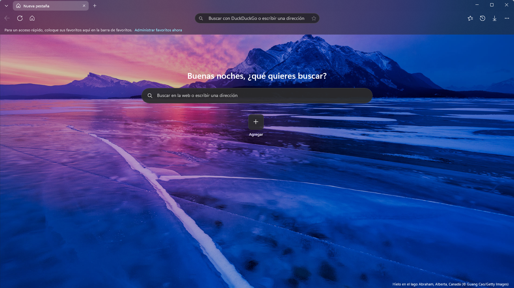
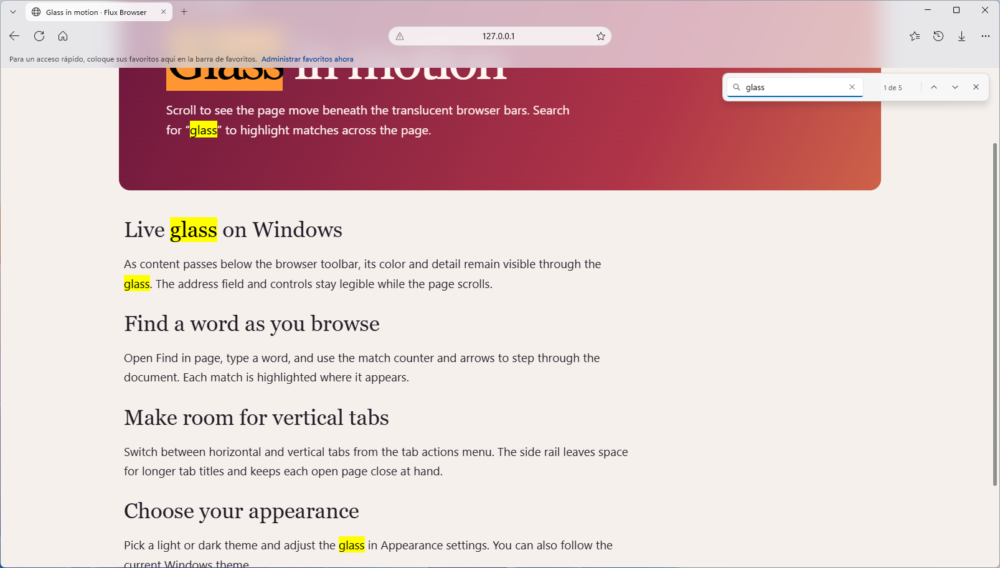
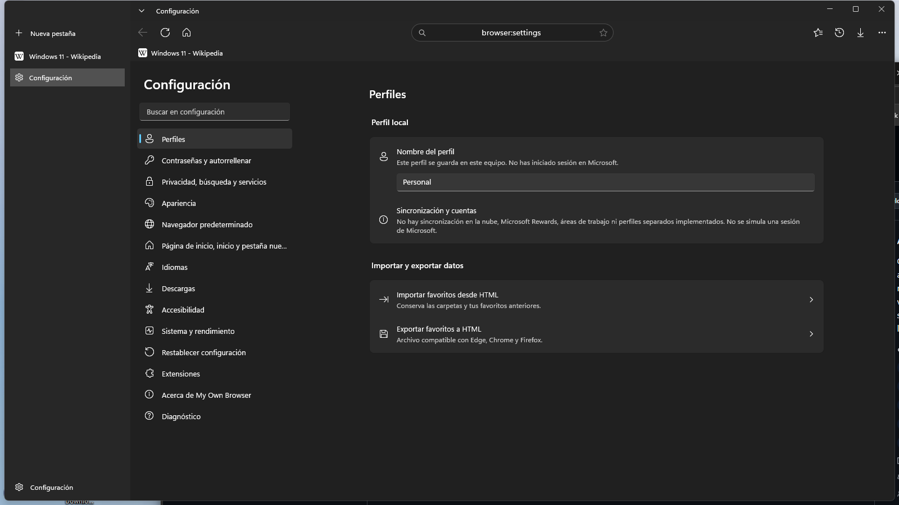

# Registro de cambios

[English](CHANGELOG.en.md) · **Español**

Cambios de Flux Browser por versión. Cada versión enlaza a sus descargas publicadas.

## [Sin publicar]

## [0.9.2] - 2026-11-13

### Resumen

- Escribe una búsqueda o dirección web inmediatamente al abrir la nueva pestaña integrada.
- GitHub muestra las mismas funciones, capturas y notas de versión en inglés y español, con el inglés primero.

### Añadido

- Páginas del proyecto en inglés y español, con la galería completa en cada una, notas de versión equivalentes y documentación de soporte.

### Capturas

### Cambiado

- La barra de direcciones y el buscador de nueva pestaña comparten el procesamiento de búsquedas y direcciones web.
- La barra de direcciones está disponible en páginas internas mientras Chromium se inicializa.

### Arreglado

- La nueva pestaña recibe el foco en cuanto su buscador está listo. El motor web oculto ya no puede quitárselo.
- Las entradas inválidas permanecen en el buscador de nueva pestaña para que puedas corregirlas.
- Las búsquedas y direcciones enviadas durante el arranque del motor se conservan y se cargan cuando está listo.

## [0.9.1] - 2026-11-13

### Cambiado

- Unifica el nombre Flux Browser en el menú de ayuda, Acerca de, diagnóstico, rutas de Windows, registro del navegador, código y empaquetado.
- Traslada el perfil anterior al directorio de Flux Browser si aún no existe uno nuevo. Conserva las carpetas de descargas que el usuario eligió.

## [0.9.0] - 2026-11-13

### Distribución

- Primera publicación con el nombre **Flux Browser** y la identidad de World Marketing Labs. El menú de ayuda enlaza al sitio de la agencia y al registro de fallos.

- Instalador EXE por usuario, ZIP portable y sumas SHA-256 para GitHub Releases.
- Galería de la aplicación, política de privacidad, plantilla de incidencias y documentación de publicación.
- Empaquetado MSIX x64 para Microsoft Store. La versión empaquetada utiliza WebView2 y recibe enlaces HTTP/HTTPS mediante activación de Windows.

### Coherencia Windows 11, animaciones en el compositor y funciones nuevas
- **Animaciones en el hilo del compositor** (WebView2): menús, paneles, barra de búsqueda, sugerencias y la entrada escalonada de la nueva pestaña ya no se calculan en el hilo de la interfaz, así que no pierden fotogramas mientras se construye su contenido. Curvas de Windows 11 (entrada desacelerada de 220 ms, salida de 130 ms) y pueden interrumpirse entre sí. Con CEF se conserva el cálculo fotograma a fotograma, porque su cristal debe seguir al menú.
- **Todos los iconos responden al clic**: se encogen al pulsar y hacen un gesto propio al activarse (atrás/adelante empujan, actualizar gira, descargas baja, inicio y nueva pestaña suben, historial y configuración se inclinan, el resto «salta»). Se anima el icono, no la placa del botón. Abarca barra de herramientas, pestañas, menús, paneles, favoritos, búsqueda y diálogos.
- **Un solo estilo de botón en las barras**: sin placa en reposo ni deshabilitado (el botón Atrás deshabilitado dejaba un cuadro gris), la misma placa tenue al pasar el ratón y al pulsar, mediante recursos de tema definidos una vez.
- **Geometría unificada**: esquinas de 4 en controles y 8 en superficies flotantes (había 4, 5, 6, 8, 10, 13 y 20 mezclados; las tarjetas de Configuración pasan de 20 a 8), iconos de la barra a 16, botones de 36×32, filas de menú de 32, iconos de etiqueta en una columna común de 16 (la fila «Zoom» quedaba 3 px desalineada) y sombra en todo lo que flota.
- **Diálogos**: botones estándar de Windows 11; el botón principal ya se rellena con el color de acento (antes un fondo transparente lo anulaba). Las líneas de «Acerca de» se ajustan y se pueden copiar en lugar de cortarse.
- **Sugerencias en la barra de direcciones**: lo que hará Entrar, pestañas abiertas («Cambiar a esta pestaña»), favoritos e historial que coinciden con lo escrito, ordenados por frecuencia y antigüedad; flechas para recorrerlas y `Esc` para cerrarlas. Todo se calcula en el equipo. Se desactiva en Privacidad.
- **Buscar en la página** rediseñado como el resto de superficies, con contador de coincidencias («3 de 236») y `F3` / `Ctrl+G`.
- **Indicador de zoom** en la barra de direcciones cuando la página no está al 100 %; un clic lo restablece.
- **Pestañas**: anillo de carga mientras la página carga e icono de altavoz cuando suena o está silenciada (clic para silenciar). Las notificaciones de una pestaña se agrupan en una sola actualización.
- **Pestañas en suspensión** (WebView2): una pestaña oculta libera memoria al minuto y se suspende unos cinco minutos después, salvo que suene, descargue o siga cargando. Se reanuda al mostrarla o al navegar en ella. Ajuste en Sistema y rendimiento.
- **Prevención de seguimiento** (WebView2) con niveles básico, equilibrado y estricto en Privacidad.
- **Atajos nuevos**: `Alt+D`, `Ctrl+RePág` / `Ctrl+AvPág`, `F3` / `Ctrl+G`, `Ctrl+Mayús+M` (silenciar) y `Ctrl+Mayús+K` (duplicar), también con la página enfocada.

#### Rendimiento
- El proceso de WebView2 se inicia en cuanto se leen los ajustes, en paralelo a la ventana; vaciar el perfil ya no bloquea el arranque (se renombra y se borra en segundo plano).
- La validación de idiomas ya no enumera todas las culturas del sistema en cada arranque.
- El historial se serializa fuera del hilo de la interfaz y en formato compacto.
- Los vínculos rápidos se leen del disco una vez por ejecución en lugar de en cada visita a la nueva pestaña; el icono de Actualizar se reutiliza en vez de recrearse en cada cambio de estado.
- El registro anota los tiempos de arranque (`ventana lista`, `primera página`).

#### Corregido
- **YouTube (y webs parecidas) se descolocaba bajo las barras**: solo se bajaban por debajo de las barras los elementos fijados en `top:0`; el riel lateral de YouTube (fijado en `top:56px`) y su contenedor principal (absoluto en `top:0`) quedaban a otra altura, así que el menú lateral se montaba sobre la cabecera y la página no crecía (cargaba muy pocos vídeos). Ahora se bajan todos los elementos fijos o pegajosos que la página ancla arriba (no los menús que la página coloca por código), el contenedor raíz de las apps maquetadas en absoluto, y los rieles que llegan al borde inferior se acortan para no perder su final. Comprobado en YouTube (ventana estrecha y ancha, scroll infinito de 36 a 71 resultados, menú ⋮ bajo su botón) y Wikipedia.
- **Se podía hacer clic a través de las barras**: el hueco libre de la fila de pestañas no detenía el puntero y el clic llegaba al enlace desplazado debajo. La fila tiene ahora fondo que detiene el puntero, y la página cubre la zona bajo las barras con una capa que absorbe clics, menú contextual y paso del ratón (la rueda sigue desplazando).
- **El navegador se cerraba al abrirse con las pestañas verticales activadas**: las filas de la lista vertical usan `RenderTransform`, y WinUI prohíbe en ellas las propiedades de escala y desplazamiento que usa la nueva animación (lanzaba una excepción al mostrar la primera fila). Esas filas se animan ahora sobre su visual de composición (opacidad y escala); comprobado arrancando con pestañas verticales, con un perfil reabierto y con una copia de la configuración real.
- **Los menús, paneles, la barra de búsqueda y las sugerencias no respondían al clic** (por ejemplo, ninguna opción del menú de los tres puntos hacía nada): su elevación con sombra se define en XAML y la animación movía esa misma elevación desde el visual de composición, lo que dejaba la superficie fuera de la detección de clics de XAML y el clic iba a la capa de cierre de debajo. Ahora se animan las propiedades del propio elemento (`UIElement.StartAnimation`); comprobado con la detección de impactos de XAML en el menú principal, historial, buscar, acciones de pestañas y nueva pestaña.
- Los iconos de sitios que rechazan peticiones sin identificar (Wikipedia, entre otros) no se cargaban nunca.
- Al cambiar de tema con las pestañas verticales, la seleccionada conservaba el color del tema anterior y quedaba ilegible.
- Al cambiar de tema con Configuración abierta, sus tarjetas se quedaban blancas con texto blanco.
- Con WebView2, tras pulsar Entrar en la barra de direcciones el foco no volvía a la página.
- «Acerca de» y Configuración decían «sin sandbox» y «laboratorio» también con WebView2, que sí lo tiene; los textos de permisos y seguimiento describen ahora cada motor.
- Rutas con barras invertidas perdidas en el README.

#### Pruebas
- Guion de interfaz para compilaciones de depuración (`FLUXBROWSER_TEST_UI`, `FLUXBROWSER_TEST_SLEEP_SECONDS`): abre cada superficie sin enviar teclas ni clics al escritorio. Con él se comprobaron tema claro y oscuro, menús, paneles, sugerencias, búsqueda, zoom, pestañas verticales, suspensión y reanudación, atajos nuevos y el arranque con CEF. Sin comprobar con dispositivos físicos: teclado, táctil y lector de pantalla.

### Pulido de barras, pestañas y desplazamiento (WebView2)
- **Barra de desplazamiento fija.** La barra nativa abarcaba toda la vista y subía con la página; ahora se dibuja dentro de la página (`page-host.js`) desde el borde inferior de las barras hasta abajo, con pulgar arrastrable, clic en la pista (avance por página con repetición) y estados de hover. La página sigue deslizándose por detrás del cristal.
- **Sin desajuste del cristal al empezar a desplazar.** El hueco bajo las barras ya no se simula moviendo el control (el `Translation` del WebView2 no se refrescaba y el cristal, que viaja por otro canal asíncrono, quedaba desfasado): la página reserva ese hueco con `padding` en la raíz, así que contenido, cristal y barra de desplazamiento viven en el mismo fotograma. Las barras son opacas con la página arriba del todo y pasan a cristal progresivamente al desplazar. Las páginas que no superan la ventana (aplicaciones, documentos cortos, visor de PDF) arrancan bajo las barras, como en cualquier navegador.
- **Menús, paneles y menú contextual sin artefactos.** El cristal de cada superficie tiene id propio, el radio exacto de la superficie, un rectángulo estático y se desvanece por CSS; los menús y paneles sobre una página solo hacen fundido (antes escala y desplazamiento arrastraban el cristal con retraso y dejaban franjas).
- **Nueva pestaña a ventana completa**: la imagen ocupa también el área de las barras, que son cristal esmerilado sobre ella (igual que una web con scroll).
- **Pestañas con la forma de Edge**: la pestaña seleccionada y la barra de herramientas comparten el mismo velo, de modo que forman una sola superficie (esquinas superiores redondeadas y «pies» curvos); ancho máximo 240 y separadores entre pestañas.
- **Arrastrar pestañas** (propio, sin arrastrar-y-soltar del sistema, que mostraba el icono de prohibido): reordenar dentro de la barra; soltarla sobre la barra de otra ventana la une a ella; soltarla en cualquier otro sitio abre una ventana nueva; la única pestaña de una ventana arrastra la ventana entera. La página se vuelve a cargar en la ventana de destino. El espacio libre de la barra mide al menos 120 px y mueve la ventana.
- **Acrílico en menús y paneles sobre una web** (menú contextual, favoritos, historial, descargas): al abrirse, la página se captura una vez, se reduce, se desenfoca y se tiñe, y esa imagen es el fondo de la superficie, colocada exactamente sobre lo que hay detrás. Exacto a cualquier escala, sin coste por fotograma y sin desajustes; durante la décima de segundo de la captura la superficie usa un relleno casi opaco.
- **Historial más rápido**: se dibuja solo una pantalla de filas y el resto al desplazar; los botones de cada fila se crean al tocarla; el filtro espera a que dejes de escribir.
- **Cabeceras y barras fijas de las webs** (`position: fixed/sticky/absolute` pegadas arriba con enlaces o controles, como el carril de Google o el menú de una web): se bajan el alto de las barras para que se vean y se puedan usar con la página arriba del todo y al desplazar. Se excluyen capas a pantalla completa y contenedores con scroll propio, y se restauran si la vista pasa a «bajo las barras».
- **Pestañas verticales**: mismas esquinas redondeadas y relleno que las normales; sin el botón de tres puntos; la «x» solo aparece al pasar el ratón y el título usa todo el ancho.
- **Configuración en ventanas estrechas**: la lista de categorías se pliega en un menú de tres rayas, siempre con icono y texto.
- **Cuadro oscuro abajo a la izquierda**: era la insignia de rendimiento (vacía con WebView2); ahora solo se muestra con el motor que tiene datos.
- **Barra de pestañas propia** (sustituye al `TabView`): las pestañas se encogen al abrir más, hasta quedar en el icono, sin botones de desplazamiento; el óvalo de la pestaña seleccionada y el del hover son la misma forma y tamaño; abrir, cerrar, reordenar y seleccionar animan posición y ancho fotograma a fotograma (interrumpibles); al cerrar con el ratón las demás conservan su ancho hasta que el puntero sale; clic central cierra. Desaparecen las líneas oscuras que dejaba la plantilla del `TabView`. El área libre para mover la ventana se calcula desde el propio diseño de la barra.
- **Tarjeta de vista previa al pasar el ratón por una pestaña**: miniatura de la página, título, dominio y memoria que usa (WebView2: memoria privada de los procesos de esa pestaña); se desliza de pestaña en pestaña con transición. Las miniaturas se capturan con la pestaña visible, tras cargar y al dejar de desplazar.
- **Parpadeo al cambiar de sitio**: el cristal de las barras ya no se desvanece en cada documento nuevo, la hoja de estilos de la página no se reescribe si no cambia, y la vista no se encoge a «bajo las barras» mientras la página aún carga.
- **Dominio centrado** en la barra de direcciones; se alinea a la izquierda al editar.
- **Cerrar la última pestaña cierra la ventana** (y el navegador si era la última).
- **Barra de direcciones**: muestra solo el dominio; al hacer clic aparece la dirección completa, seleccionada.
- **Nueva pestaña**: el cursor queda en su cuadro de búsqueda; una pestaña recién creada ya no puede quedarse invisible por una animación sin terminar.
- **Menús y paneles sobre una página**: relleno casi opaco en lugar de un rectángulo de cristal dibujado por la página (con la opacidad de los menús apenas se notaba el desenfoque y el rectángulo podía desalinearse y costaba rendimiento). El cristal se mantiene en las barras.
- **Parpadeo negro al cargar**: el fondo por defecto del control web es ahora opaco (blanco, u oscuro con tema oscuro) en vez de transparente.
- **Zoom por CSS**: el ancho de la raíz se compensa solo con el modelo de zoom antiguo de Chromium; con el actual quedaba una columna vacía a la derecha.

### Motor WebView2 predeterminado (con sandbox); CEF como respaldo
- `IWebSession` desacopla la interfaz del motor; CEF se conserva como respaldo y su comportamiento no cambió.
- `WebView2Session`: pestañas dentro del sandbox de Chromium, servidas por el Runtime de WebView2. Navegación, favicon, descargas, nuevas ventanas, impresión, captura, MHTML, borrado de datos.
- **Cristal en la página** (`Assets/page-host.js`): `backdrop-filter` inyectado desde el host; verificado a 120 Hz, con zoom y en PDF, páginas de error y `view-source`. La página reserva el hueco bajo la barra con `padding` en la raíz (sin reflujo ni traslación del control).
- **Zoom por CSS**, con el cristal compensado. Limitación: sitios con `vw` o anchos fijos se desbordan al ampliar.
- **Atajos con la web enfocada**: canal propio en un mundo aislado de la página (solo teclas de confianza, imposible de falsificar desde un sitio), con los aceleradores nativos desactivados. El control web ahora tiene nombre accesible.
- **Predeterminado:** WebView2 si el equipo tiene el Runtime (se registra la versión); si no, CEF. `FLUXBROWSER_ENGINE=cef|webview2` fuerza uno. La prueba de humo de `publish.ps1` arranca los dos.
- **Pestañas y ventanas privadas** con perfil InPrivate del motor y `--private`; aislamiento de cookies comprobado con un servidor local.
- **Menú contextual propio** con el material de cristal; **buscar en la página nativo**; **permisos con aviso por sitio** del motor; sesiones activadas en perfiles nuevos; sin compositor GPU en este modo; ajustes de rendimiento de CEF sustituidos por una nota.
- Huecos conocidos (zoom CSS en sitios con `vw`, pruebas con teclado físico, IME, táctil y lector de pantalla): ver `docs/MIGRACION-WEBVIEW2.md`, sección 13.

### Añadido en la segunda pasada
- **Instalador por usuario** (`install.ps1` / `uninstall.ps1` dentro del zip): copia, acceso directo, registro como navegador y entrada de «Aplicaciones instaladas». Probado instalando y desinstalando.
- **Registro como navegador de Windows** (`--register`, `--unregister`, y botón en Configuración): HTTP y HTTPS aparecen en «Aplicaciones predeterminadas». Solo toca HKCU y solo quita su propio registro.
- **Sesiones persistentes opcionales** («Mantener las sesiones iniciadas»), desactivadas de serie por la falta de sandbox.
- **Recuperación ante fallo de GPU**: «Reiniciar navegador» guarda las pestañas normales y las reabre en un proceso nuevo; también en Más herramientas.
- **Restauración perezosa**: las pestañas guardadas no crean su sesión de Chromium hasta seleccionarlas (con 4 pestañas guardadas: 2 procesos de renderizado al arrancar, 3 tras abrir otra). Las sesiones guardan el título.
- **Una instancia por perfil**: una copia con `FLUXBROWSER_PROFILE` ya no choca con la que tienes abierta.
- **Pruebas xUnit** (89), flujo de integración continua y Dependabot semanal para mantener CefSharp/Chromium al día (el flujo de GitHub no se ha podido ejecutar localmente).

### Corregido
- **Cierre inesperado al cargar ciertos favicons** (p. ej. iana.org): un icono ICO paletizado lanzaba `InvalidDataException`, que escapaba de un `async void` y cerraba el navegador con todas las pestañas. Ahora se decodifica con el códec de Windows y cualquier fallo de icono se ignora.
- **La versión publicada no arrancaba** («XAML parsing failed»): `dotnet publish` de WinUI sin empaquetar no incluía los `.xbf` ni el `.pri`. El `.csproj` los añade y el script de publicación lo comprueba abriendo el ejecutable.
- Un `settings.json` con valores no válidos quedaba cargado igualmente (se asignaba antes de validar). Ahora se mantienen los valores predeterminados.
- `Esc` no detenía la carga aunque el botón Detener lo anunciaba.
- Los movimientos del ratón se bloqueaban tras el bloqueo del compositor mientras la GPU esperaba la copia del fotograma; la espera ahora ocurre fuera del bloqueo y la consulta del desplazamiento superior no lo toma.

### Seguridad
- Los iconos de sitios que apuntan a direcciones locales o privadas (loopback, 10/8, 172.16/12, 192.168/16, enlace local, `.local`…) se ignoran salvo que la propia página esté en ese host; una web pública ya no puede hacer que el proceso del navegador sondee la red local.
- Abrir desde Descargas un archivo ejecutable o script (`.exe`, `.msi`, `.bat`, `.ps1`, `.js`, `.lnk`…) pide confirmación.
- Chromium arranca sin tráfico de fondo a servicios externos (`disable-background-networking`, `disable-sync`, `disable-domain-reliability`, `no-pings`).
- Los archivos del perfil de más de 32 MB se rechazan al leerlos.
- Los argumentos de línea de comandos solo aceptan URL HTTP/HTTPS explícitas, hasta 20.

### Rendimiento
- Las animaciones usan el fotograma real de composición (`CompositionTarget.Rendering`) en lugar de temporizadores de 8/16 ms, y solo se suscriben mientras hay algo animándose.
- Escritura de sesión e historial diferida y agrupada fuera del hilo de la interfaz (antes: JSON indentado completo en cada navegación).
- `UISettings` se reutiliza en lugar de crearse en cada animación.
- Publicación con ReadyToRun y PGO por niveles; idiomas innecesarios eliminados (−48 MB).

### Añadido
- Icono de la aplicación (`tools\make-icon.ps1`), metadatos de versión y icono de ventana.
- Efectos: barra de progreso de carga que aparece y se desvanece, entrada escalonada de la página de nueva pestaña, rebote de resorte al pasar el ratón y pulsar los botones de la barra y los accesos rápidos (en el hilo del compositor; respetan «Animaciones» y la preferencia de Windows).
- Direcciones por línea de comandos, también hacia una instancia ya abierta.
- Variable `FLUXBROWSER_PROFILE` para carpeta de perfil alternativa.
- Registro de errores con rotación y red de seguridad para excepciones asíncronas (se registran y se avisan en lugar de cerrar la aplicación).
- `tools\publish.ps1`: pruebas, publicación autocontenida, prueba de humo, zip y SHA-256.
- Pruebas para línea de comandos, filtrado de hosts privados y almacenamiento diferido (ahora en xUnit).
- `.editorconfig`, `.gitignore` ampliado, versión en «Acerca de».

[Sin publicar]: https://github.com/cbatista96/FluxBrowser/compare/v0.9.2...HEAD
[0.9.2]: https://github.com/cbatista96/FluxBrowser/releases/tag/v0.9.2
[0.9.1]: https://github.com/cbatista96/FluxBrowser/releases/tag/v0.9.1
[0.9.0]: https://github.com/cbatista96/FluxBrowser/releases/tag/v0.9.0
