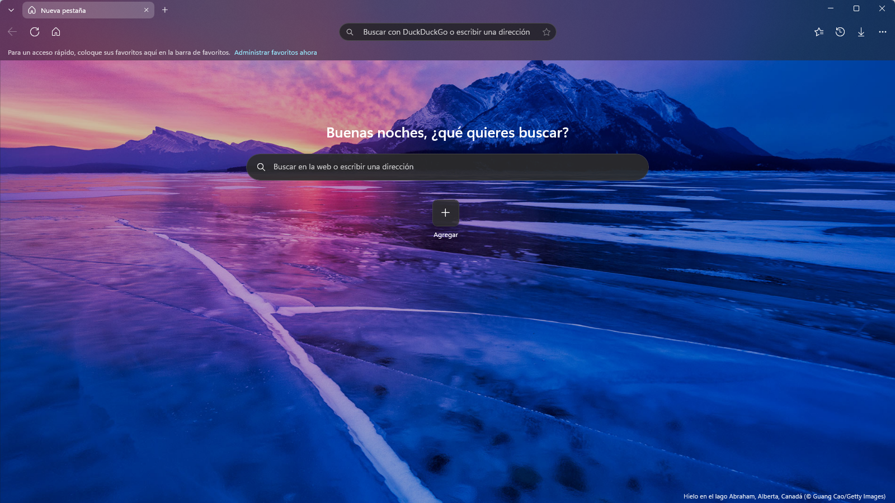
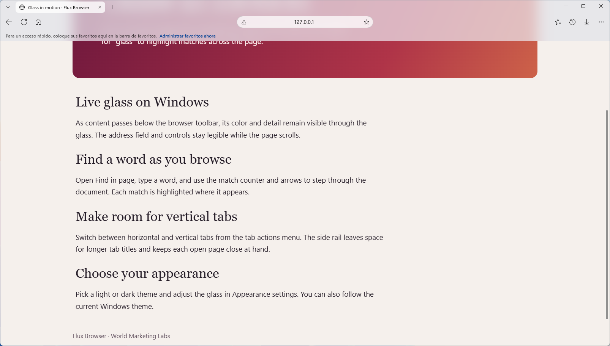
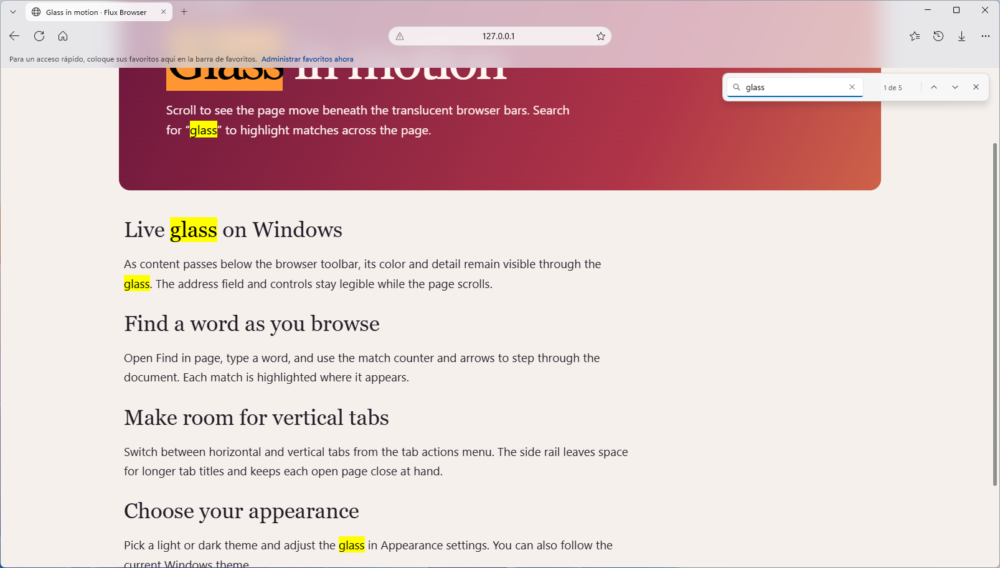
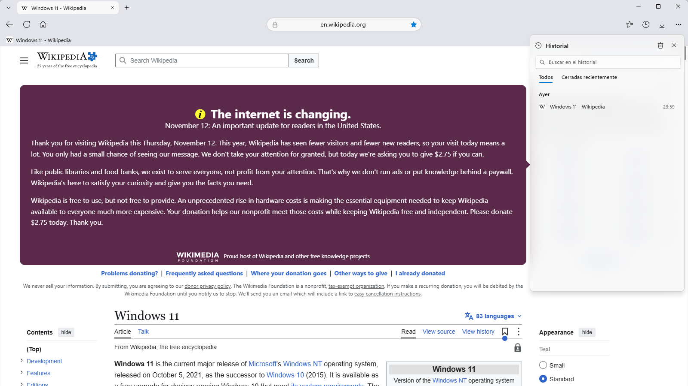
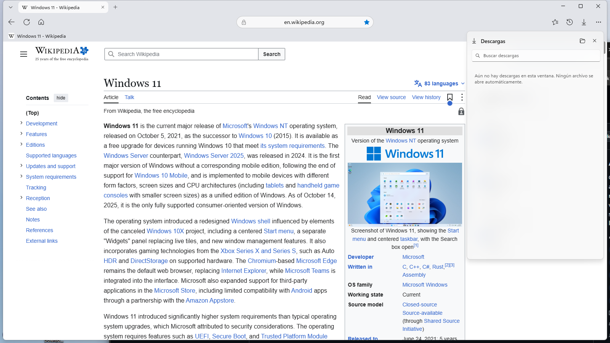
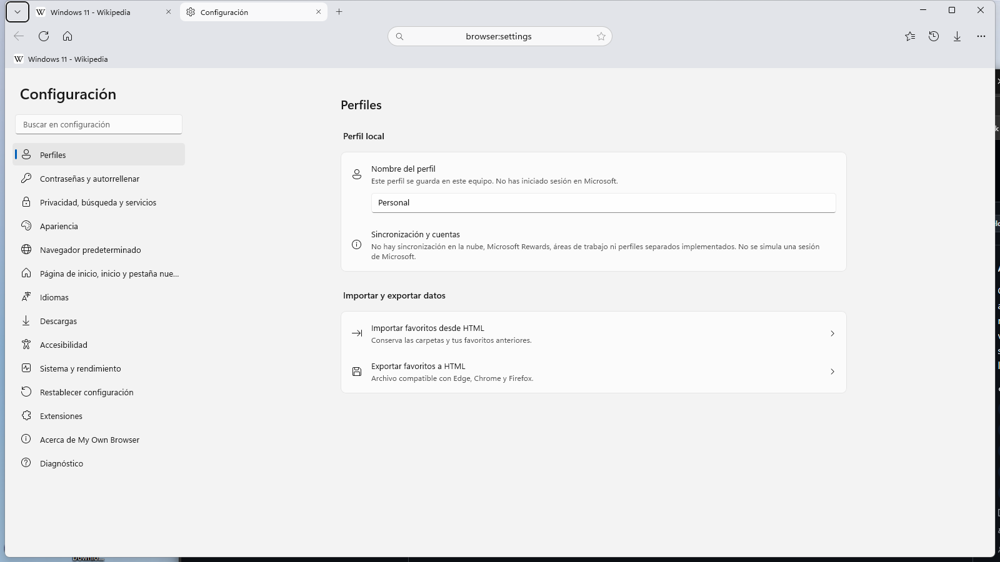
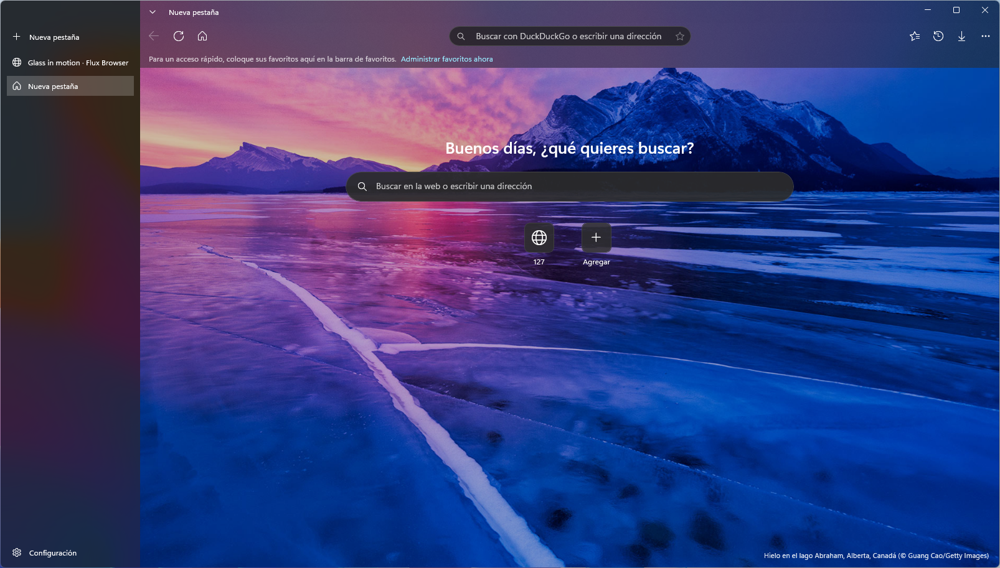
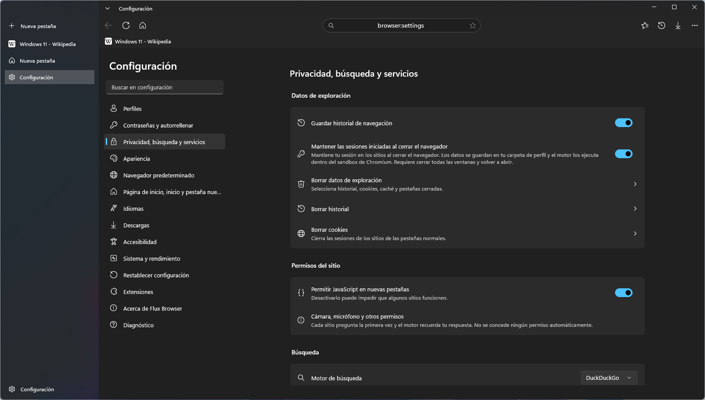
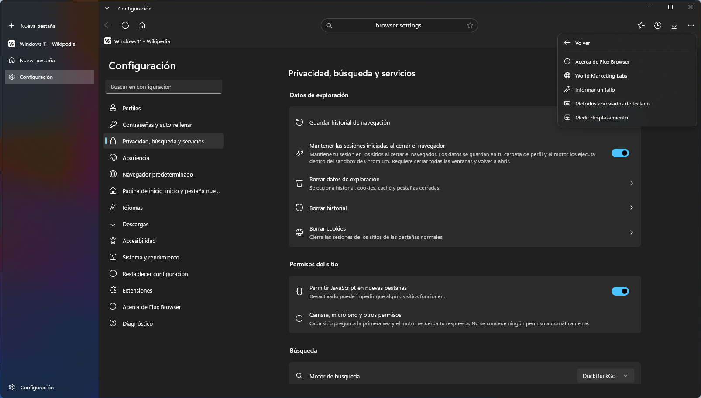
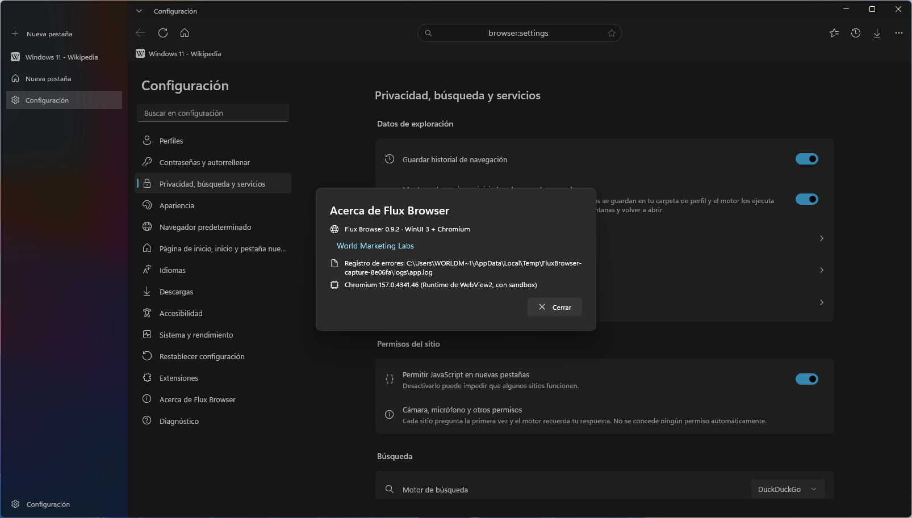

[English](README.md) · **Español** · Historial [English](CHANGELOG.en.md) / [Español](CHANGELOG.md)

<div align="center">


# Flux Browser

**Un navegador para Windows con cristal en vivo, pestañas verticales y controles de navegación locales.**

Desarrollado por [World Marketing Labs](https://www.worldmarketinglabs.com/es).

[](https://github.com/cbatista96/FluxBrowser/actions/workflows/ci.yml)
[](https://github.com/cbatista96/FluxBrowser/releases/tag/v0.9.2)
[](https://github.com/cbatista96/FluxBrowser/releases)

### [Descargar Flux Browser](https://github.com/cbatista96/FluxBrowser/releases/tag/v0.9.2)

[Funciones](#todas-las-funciones) · [Capturas](#capturas) · [Historial](CHANGELOG.md) · [Informar un fallo](https://github.com/cbatista96/FluxBrowser/issues/new/choose)



</div>

## Novedades de 0.9.2

- La nueva pestaña integrada activa el campo de búsqueda para escribir una consulta o dirección de inmediato.
- El proyecto en GitHub y las notas de versión presentan las mismas funciones y capturas en inglés y español.

[Notas completas](https://github.com/cbatista96/FluxBrowser/releases/tag/v0.9.2)

## Todas las funciones

| Área | Qué puedes hacer |
| --- | --- |
| **Pestañas y ventanas** | Pestañas horizontales y verticales. Fija, silencia, duplica, reordena, mueve a otra ventana, agrupa por sitio, busca y reabre pestañas. Recupera sesiones normales al iniciar. |
| **Nueva pestaña y barra de direcciones** | Escribe una búsqueda o dirección web al abrir una pestaña nueva. Elige DuckDuckGo, Bing o Google. La barra sugiere pestañas abiertas, favoritos e historial de forma local. La nueva pestaña integrada muestra accesos fijados y frecuentes y, opcionalmente, una imagen de Bing. |
| **Favoritos e historial** | Organiza favoritos en carpetas anidadas. Importa o exporta HTML de Netscape, incluidas carpetas vacías. Busca en el historial local y recupera pestañas normales cerradas. |
| **Descargas** | Consulta el progreso y cancela descargas. Elige la carpeta de destino o pregunta dónde guardar cada archivo. Los archivos permanecen en disco tras cerrar la ventana. |
| **Privacidad** | Abre ventanas privadas, borra datos de navegación seleccionados y elige un nivel de prevención de seguimiento en WebView2. Los sitios piden permiso antes de acceder a la cámara o al micrófono. |
| **Apariencia y accesibilidad** | Barras translúcidas con desenfoque en vivo, temas claro y oscuro, opacidad regulable, animaciones opcionales, botones configurables, atajos y controles de fuentes. |
| **Herramientas de página** | Busca en la página con contador en WebView2, amplía, imprime, captura páginas, guarda MHTML, consulta el código fuente HTTP/HTTPS, abre DevTools y usa pantalla completa. |
| **Rendimiento y configuración** | WebView2 suspende pestañas inactivas cuando es posible. Configuración incluye búsqueda, inicio, página principal, idiomas, corrector, JavaScript y restauración de sesión. El diagnóstico integrado registra el arranque y los errores. |
| **Integración con Windows** | Instala por usuario o ejecuta desde el ZIP portable descomprimido. Windows permite elegir Flux Browser para abrir enlaces HTTP y HTTPS. Hay un MSIX separado para pruebas de Store. |

## Capturas

Las capturas muestran la interfaz actual del navegador en español. La página en inglés presenta las mismas vistas con sus títulos traducidos.

### Nueva pestaña y vínculos rápidos


### Barra translúcida al desplazar la página



### Buscar en la página



### Menú principal


### Favoritos


### Historial



### Descargas



### Configuración



### Pestañas verticales y tema oscuro



### Controles de privacidad



### Ayuda y comentarios



### Acerca de Flux Browser



## Descarga e instalación

| Descarga | Uso |
| --- | --- |
| [Instalador EXE](https://github.com/cbatista96/FluxBrowser/releases/download/v0.9.2/FluxBrowser-Setup-0.9.2-win-x64.exe) | Instala para el usuario actual y añade un acceso al menú Inicio. |
| [ZIP portable](https://github.com/cbatista96/FluxBrowser/releases/download/v0.9.2/FluxBrowser-0.9.2-win-x64.zip) | Descomprime la carpeta completa y ejecuta `FluxBrowser.exe`. |
| [SHA256SUMS.txt](https://github.com/cbatista96/FluxBrowser/releases/download/v0.9.2/SHA256SUMS.txt) | Compara las sumas con `Get-FileHash -Algorithm SHA256`. |

## Requisitos

Windows 10 2004 o posterior, x64. La descarga incluye .NET. WebView2 Evergreen es el motor recomendado y el paquete de Store lo requiere. La compilación de GitHub incluye un respaldo experimental CEF, que requiere gráficos Direct3D 11 compatibles y se ejecuta sin el sandbox de Chromium. Usa WebView2 para navegar habitualmente.

## Compilar y probar

Desde la raíz del repositorio, usa el SDK de .NET seleccionado por `global.json`.

```powershell
dotnet build FluxBrowser/FluxBrowser.csproj -p:Platform=x64
dotnet test FluxBrowser.Tests/FluxBrowser.Tests.csproj
pwsh -File tools/publish.ps1
```

## Soporte, privacidad y firma

- [Fallos conocidos](docs/FALLOS-CONOCIDOS.md) · [Informar un fallo](https://github.com/cbatista96/FluxBrowser/issues/new/choose)
- [Política de privacidad](docs/PRIVACIDAD.md) · [Informes de seguridad](SECURITY.es.md)
- [Preparación para Microsoft Store](docs/MICROSOFT-STORE.md) · [Guía detallada](docs/GUIA.es.md)
- GitHub firma una atestación para la versión inmutable. El instalador se publica sin Authenticode.
