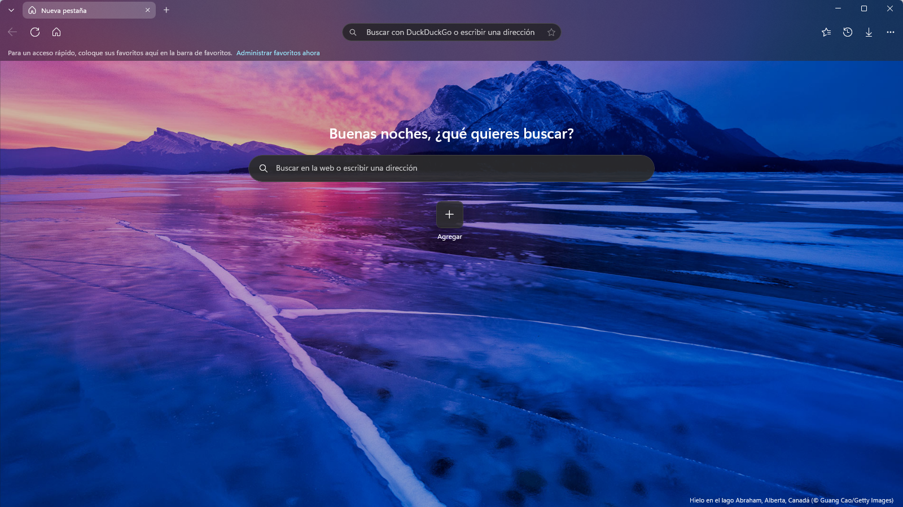
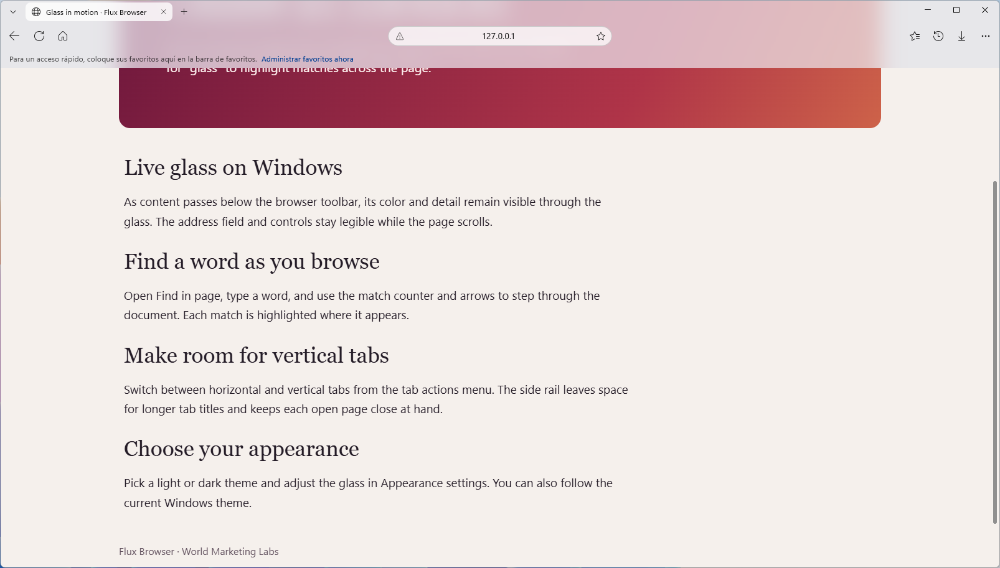
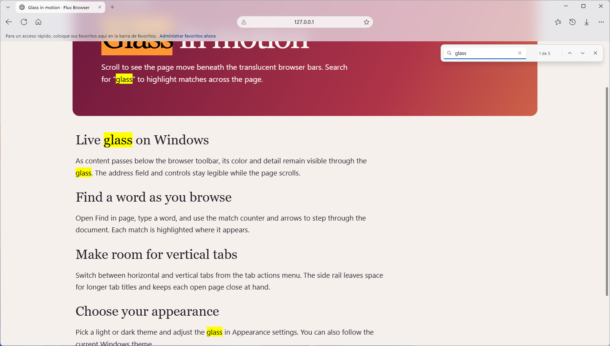
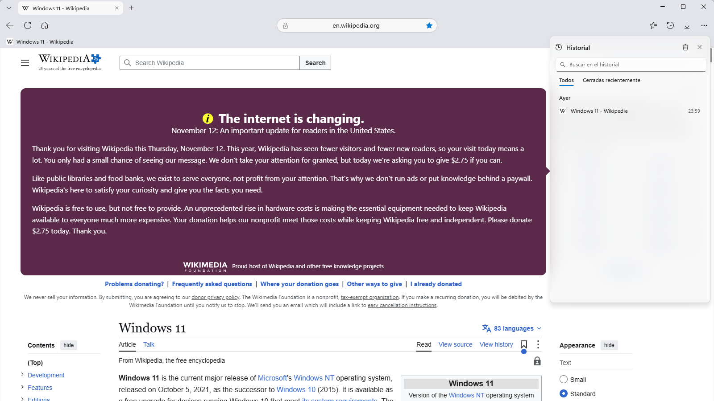
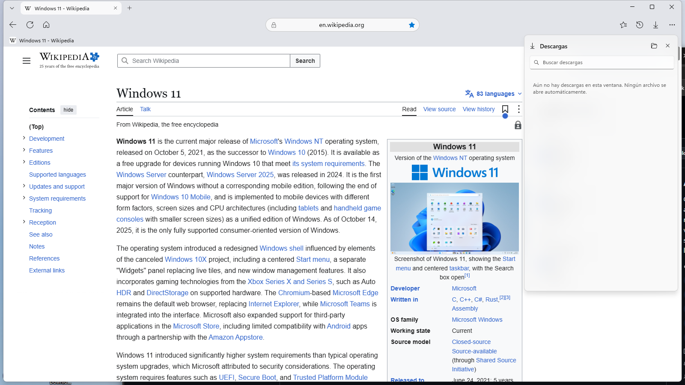
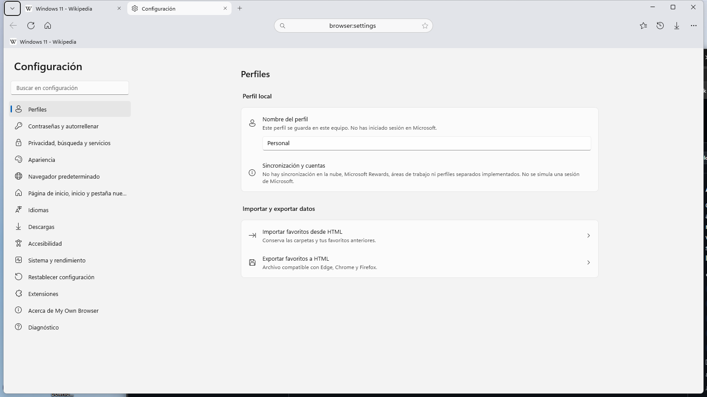
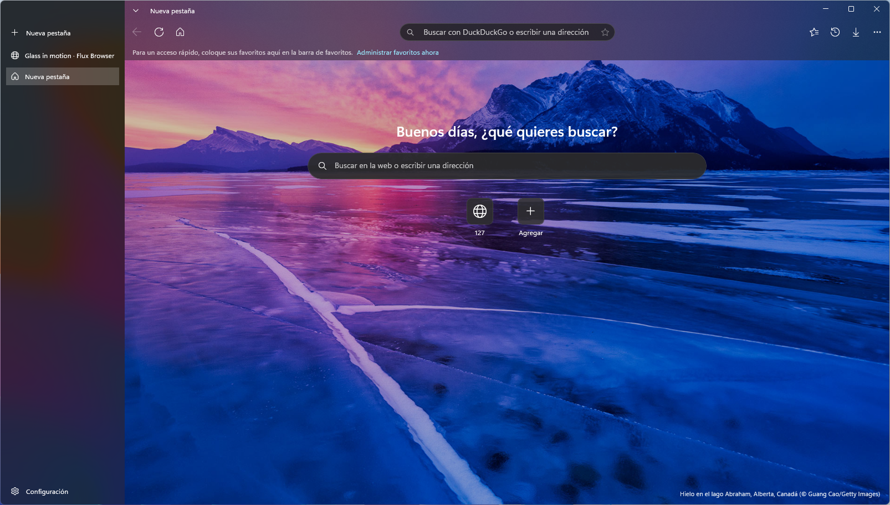
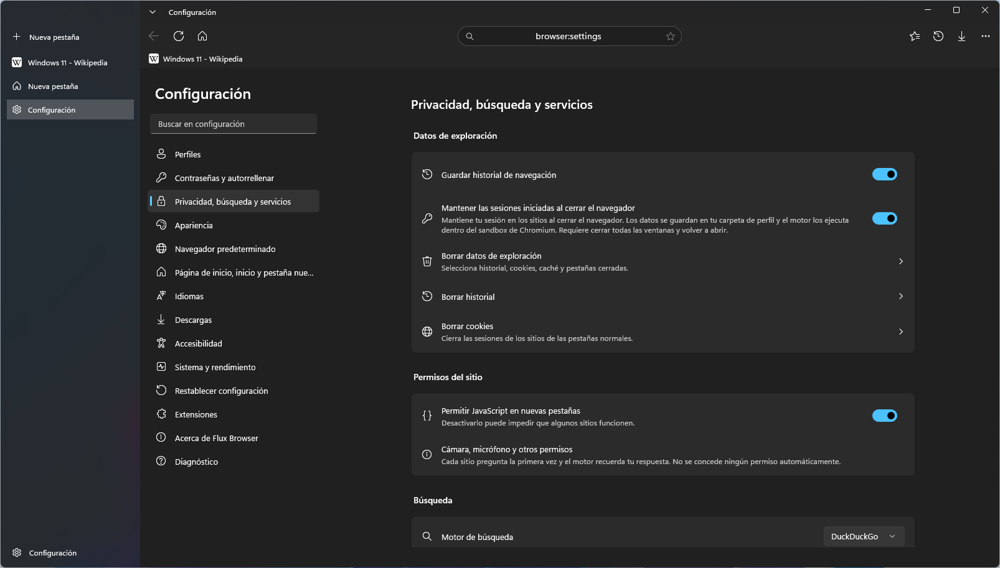
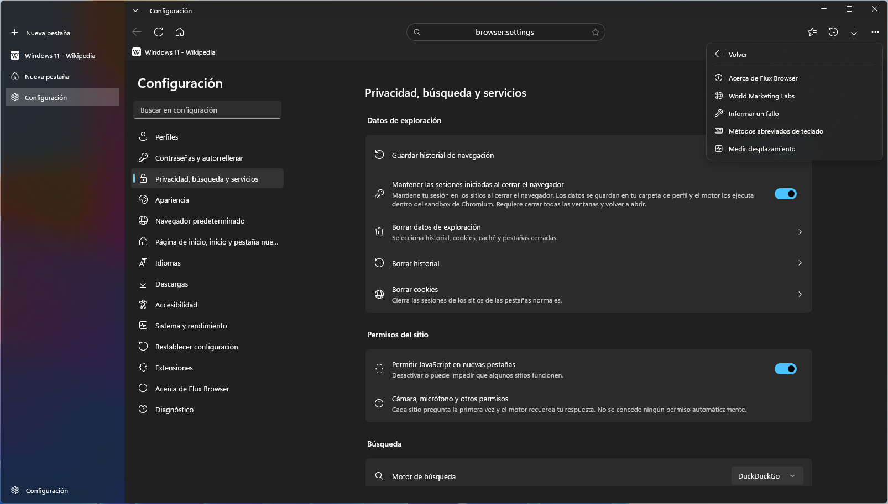
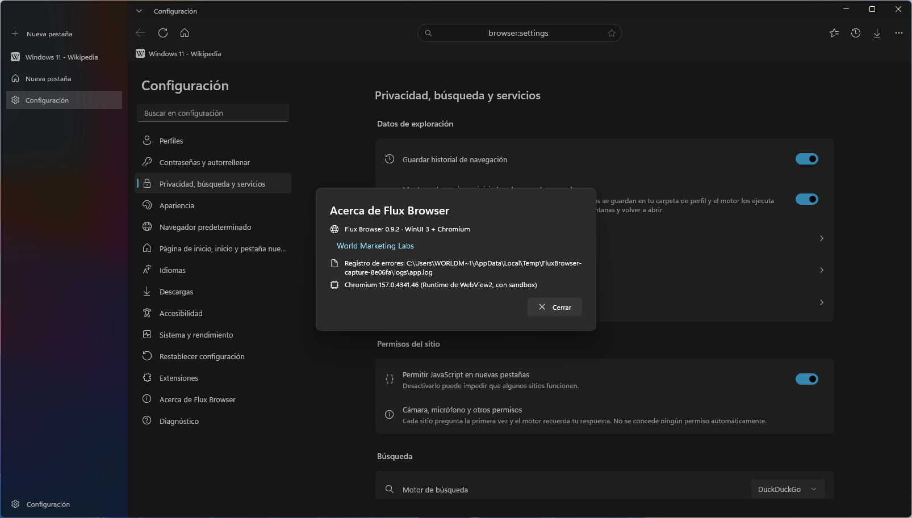

**English** · [Español](README.es.md) · Changelog [English](CHANGELOG.en.md) / [Español](CHANGELOG.md)

<div align="center">


# Flux Browser

**A Windows browser with live glass, vertical tabs and local browsing controls.**

Built by [World Marketing Labs](https://www.worldmarketinglabs.com/en).

[](https://github.com/cbatista96/FluxBrowser/actions/workflows/ci.yml)
[](https://github.com/cbatista96/FluxBrowser/releases/tag/v0.9.2)
[](https://github.com/cbatista96/FluxBrowser/releases)

### [Download Flux Browser](https://github.com/cbatista96/FluxBrowser/releases/tag/v0.9.2)

[Features](#all-features) · [Screenshots](#screenshots) · [Changelog](CHANGELOG.en.md) · [Report a bug](https://github.com/cbatista96/FluxBrowser/issues/new/choose)



</div>

## New in 0.9.2

- The built-in new tab focuses its search field so you can type a search or web address immediately.
- The GitHub project and release notes present the same features and screenshots in English and Spanish.

[Full release notes](https://github.com/cbatista96/FluxBrowser/releases/tag/v0.9.2)

## All features

| Area | What you can do |
| --- | --- |
| **Tabs and windows** | Horizontal and vertical tabs. Pin, mute, duplicate, reorder, detach to another window, group by site, find open tabs and reopen recently closed ones. Restore regular sessions on startup. |
| **New tab and address bar** | Start typing a query or a web address as soon as you open a new tab. Pick DuckDuckGo, Bing or Google. The address bar suggests open tabs, bookmarks and history locally. The built-in new tab also has pinned and frequently visited shortcuts and an optional Bing image. |
| **Bookmarks and history** | Organize bookmarks in nested folders. Import or export Netscape HTML, including empty folders. Search local history and reopen recently closed regular tabs. |
| **Downloads** | Track progress and cancel downloads. Choose the destination folder or ask where to save each file. Files remain on disk after the window closes. |
| **Privacy** | Open private windows, clear selected browsing data and choose a tracking prevention level in WebView2. Sites ask before accessing protected capabilities such as the camera or microphone. |
| **Appearance and accessibility** | Translucent bars with live blur, light and dark themes, adjustable opacity, optional animations, configurable toolbar buttons, keyboard shortcuts and font controls. |
| **Page tools** | Find in page with a match count in WebView2, zoom, print, capture a page, save MHTML, view HTTP/HTTPS source, open DevTools and enter fullscreen. |
| **Performance and settings** | WebView2 suspends eligible background tabs. Settings include search, startup and home pages, languages, spellcheck, JavaScript and configurable session restoration. Built-in diagnostics record startup and application errors. |
| **Windows integration** | Install per user or run from an extracted portable ZIP. Windows lets you choose Flux Browser to open HTTP and HTTPS links. A separate MSIX is available for Store testing. |

## Screenshots

Screenshots show the current Spanish-language browser interface. The same views and captions are available on the Spanish project page.

### New tab and quick links


### Translucent toolbar while scrolling



### Find in page



### Main menu


### Bookmarks


### History



### Downloads



### Settings



### Vertical tabs and dark theme



### Privacy controls



### Help and feedback



### About Flux Browser



## Download and install

| Download | Use |
| --- | --- |
| [Installer EXE](https://github.com/cbatista96/FluxBrowser/releases/download/v0.9.2/FluxBrowser-Setup-0.9.2-win-x64.exe) | Installs for the current user and adds a Start menu shortcut. |
| [Portable ZIP](https://github.com/cbatista96/FluxBrowser/releases/download/v0.9.2/FluxBrowser-0.9.2-win-x64.zip) | Extract the whole folder and run `FluxBrowser.exe`. |
| [SHA256SUMS.txt](https://github.com/cbatista96/FluxBrowser/releases/download/v0.9.2/SHA256SUMS.txt) | Compare the checksums using `Get-FileHash -Algorithm SHA256`. |

## Requirements

Windows 10 2004 or later, x64. The download includes .NET. WebView2 Evergreen is the recommended engine and is required by the Store package. The GitHub build also includes an experimental CEF fallback, which requires compatible Direct3D 11 graphics and runs without Chromium's sandbox. Use WebView2 for regular browsing.

## Build and test

From the repository root, use the .NET SDK selected by `global.json`.

```powershell
dotnet build FluxBrowser/FluxBrowser.csproj -p:Platform=x64
dotnet test FluxBrowser.Tests/FluxBrowser.Tests.csproj
pwsh -File tools/publish.ps1
```

## Support, privacy and signing

- [Known issues](docs/KNOWN-ISSUES.md) · [Report a bug](https://github.com/cbatista96/FluxBrowser/issues/new/choose)
- [Privacy policy](docs/Privacy.md) · [Security reporting](SECURITY.md)
- [Microsoft Store preparation](docs/MICROSOFT-STORE.en.md) · [Detailed guide (Spanish)](docs/GUIA.es.md)
- GitHub signs an attestation for the immutable release. The installer is published without Authenticode.
