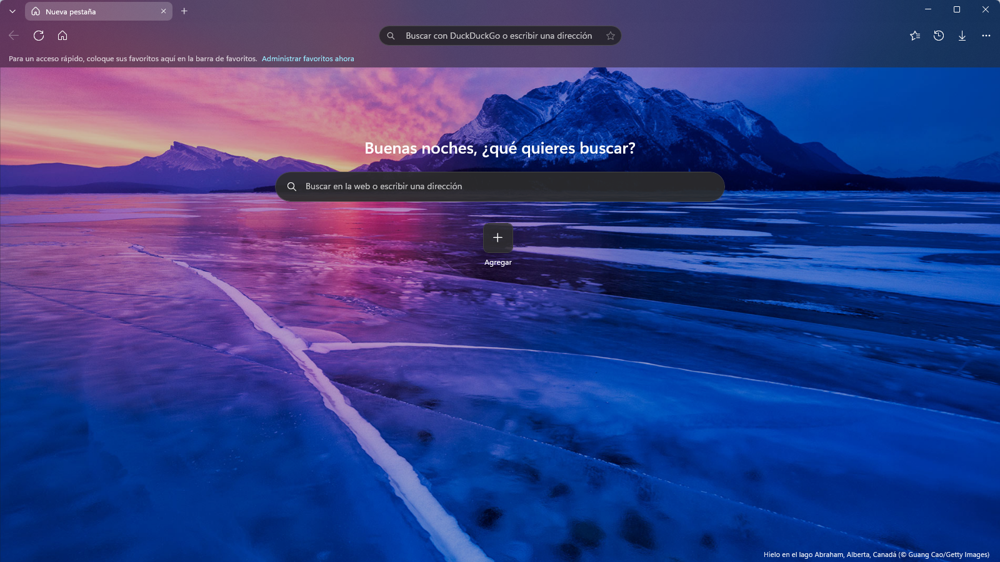
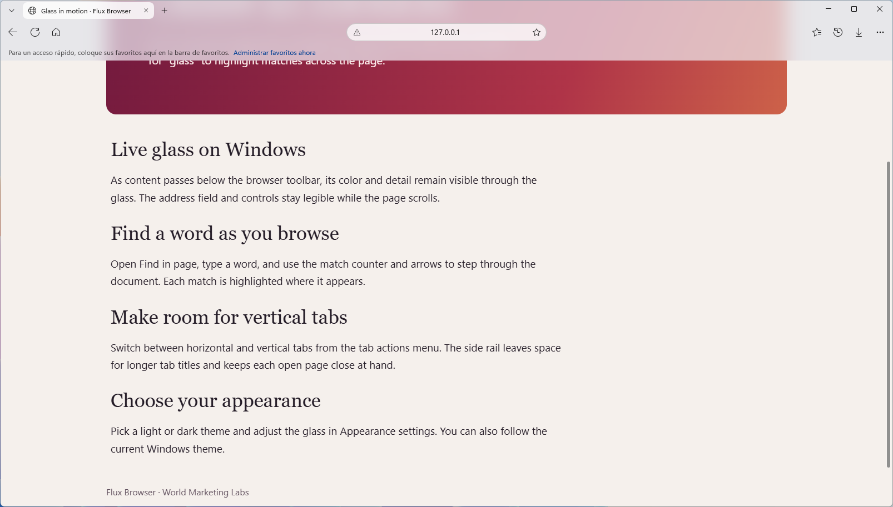
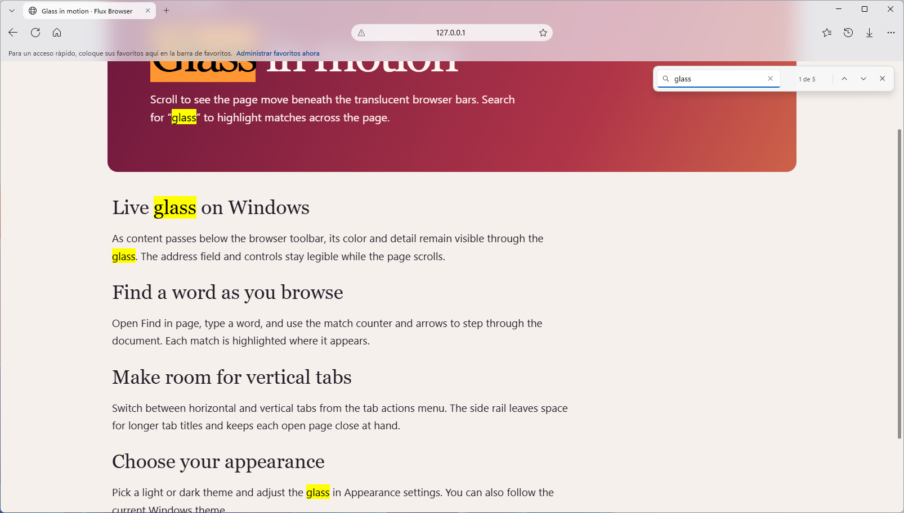
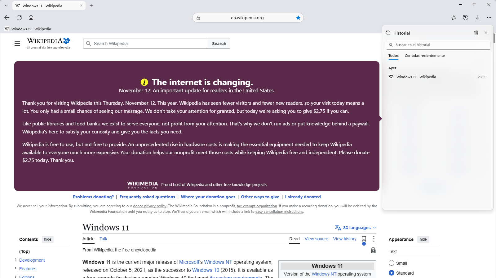
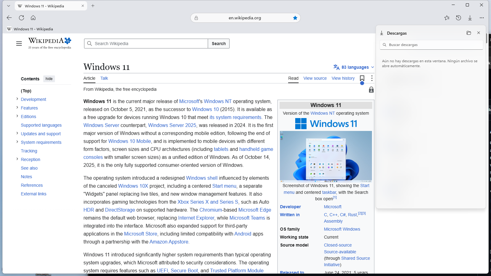
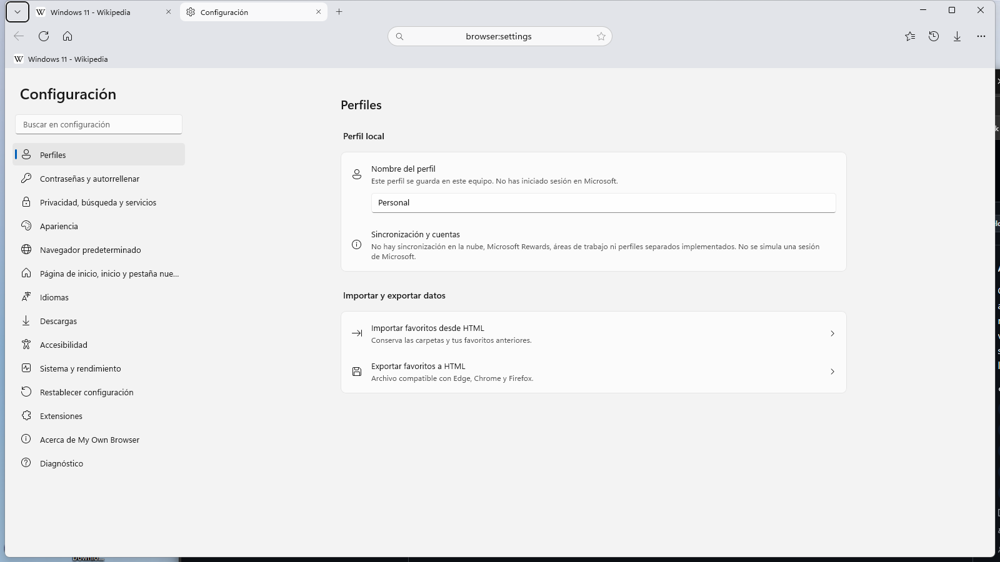
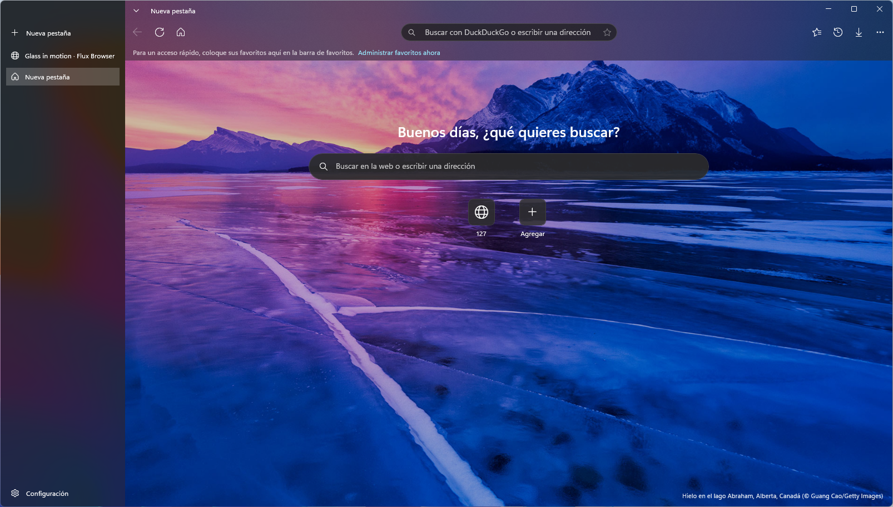
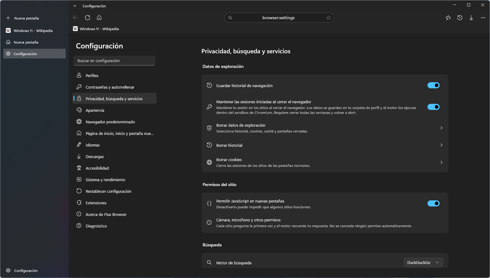
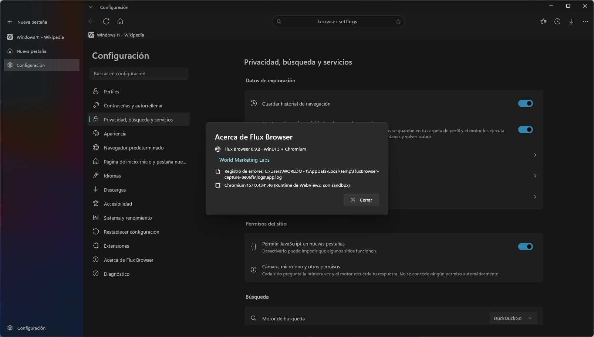
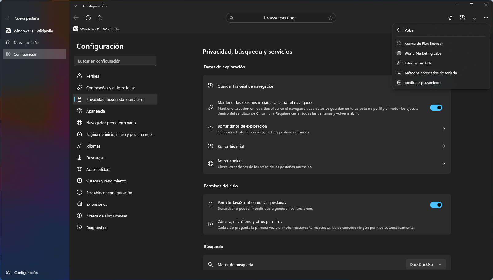

# Galería de Flux Browser

Capturas de Flux Browser en Windows con un perfil de prueba. Las vistas con pestañas verticales se tomaron con la ventana activa y centrada para mostrar el acrílico sobre el fondo del escritorio.

### Nueva pestaña

### Navegación con barras translúcidas

### Buscar dentro de la página

### Menú principal

### Panel de favoritos

### Panel de historial

### Panel de descargas

### Configuración

### Pestañas verticales y tema oscuro

### Privacidad y prevención de seguimiento

### Acerca de

### Ayuda y comentarios

